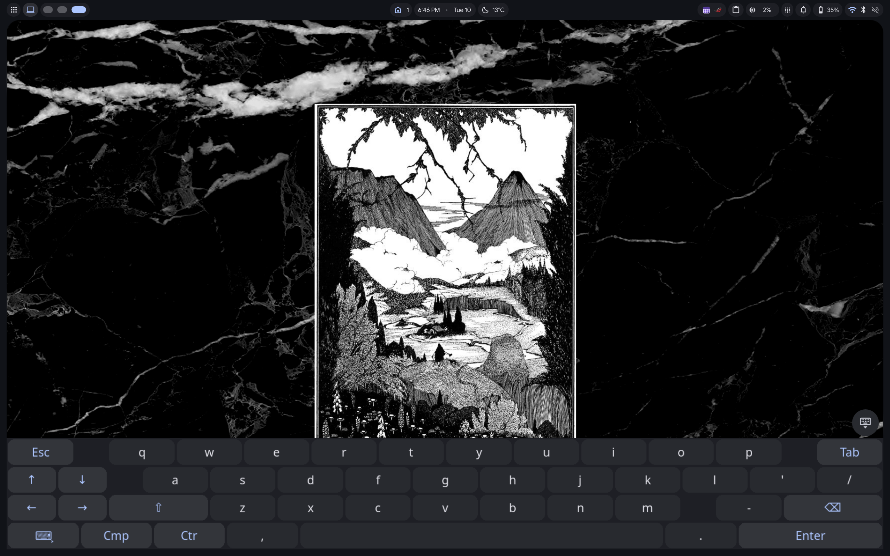
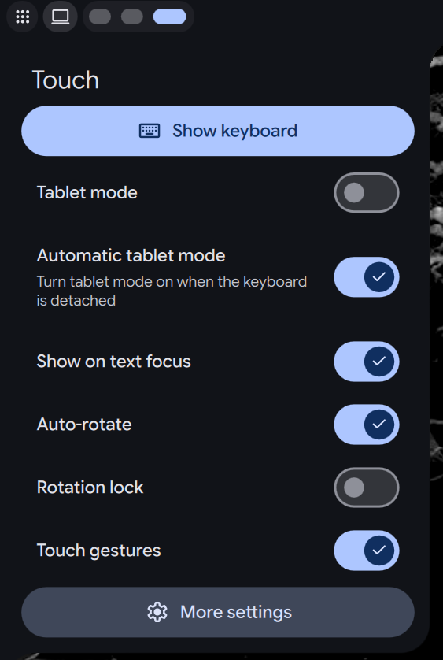

# Touch (duxTouch)


On-screen keyboard (wvkbd or the Virtual Keyboard plugin), tablet mode, auto-rotation and touch gestures. Works on any compositor with layer-shell and wlr-output-management; touch gestures need Hyprland for now.

## Screenshots

| On-screen keyboard | Quick settings |
| --- | --- |
|  |  |

## Features

### On-screen keyboard
- Pick a backend in settings: [wvkbd](https://github.com/jjsullivan5196/wvkbd), or the [Virtual Keyboard](https://github.com/sitolam/dux-plugins/tree/main/plugins/virtualkeyboard) plugin if it's enabled. Only installed backends are offered; if neither is, the setting says so.
- With wvkbd: themed from the shell (colors, font and corner radius follow the current theme and update when it changes), choice of variant, portrait and landscape heights, and layers. A hide button sits just above the keyboard. Outside tablet mode it runs only while shown.
- With the Virtual Keyboard plugin: its own window, pill and settings apply; this plugin only shows/hides/toggles it.
- Toggle it from the bar icon, the control center tile, a touch gesture or IPC.

### Tablet mode
- Keeps the keyboard running in the background, so it opens instantly.
- **Show on text focus:** the keyboard opens by itself when a text field is focused (Hyprland only).
- **Automatic tablet mode:** detaching the last external keyboard turns tablet mode on, and attaching one turns it off. Tablet mode you turned on yourself is never switched off.
- Follows the hardware tablet-mode switch on convertibles (needs the `input` group and the "Follow key presses and the tablet switch" setting).

### Physical keyboards
- Detects USB and Bluetooth keyboards. Built-in laptop keyboards never count as external.
- Attaching a keyboard hides the on-screen keyboard.
- Typing on an external keyboard hides it (needs the `input` group and the "Follow key presses and the tablet switch" setting).
- One toggle turns all of this off.

### Auto-rotation
- Rotates the screen from the accelerometer (iio-sensor-proxy).
- Rotates the built-in display by default, or a display you choose.
- Rotation lock in quick settings, the control center and IPC.
- The rotation survives Hyprland config reloads.

### Touch gestures (Hyprland only, for now)
- Built on hyprgrass: edge swipes, multi-finger swipes, taps, pinches and long presses.
- Gesture editor. Each gesture runs one of: next or previous workspace, close, fullscreen, float, drag window, toggle keyboard, control center, launcher, notifications, or a custom command.
- Defaults:
  - swipe in from the right or left edge: next or previous workspace
  - swipe up from the bottom edge: keyboard
  - swipe down from the top edge: control center
  - 3-finger swipe down: close the window
  - 3-finger long press: drag the window
- Tunables: sensitivity, long press delay, edge size, held touches, and Hyprland's touchscreen workspace swipe.
- One-click hyprgrass install and a one-click config hookup.

### Controls
- **Bar icon:** shows tablet or laptop mode and lights up while the keyboard is shown. Tap toggles the keyboard; long-press or right-click opens quick settings.
- **Quick settings:** keyboard, tablet mode, automatic tablet mode, show on text focus, physical keyboard detection, hide on key press, auto-rotate, rotation lock, gestures, and a link to all settings.
- **Control center tile:** tap toggles the keyboard; the detail view shows the same quick settings.
- **IPC** for scripts and keybinds (see [IPC](#ipc)).

### Idle cost
No polling and no timers. Nothing runs while idle except one sleeping watcher, and only while physical keyboard detection or the tablet-mode switch option is on. It's `udevadm` (hotplug only, cheap) unless you turn on "Follow key presses and the tablet switch", which switches it to `libinput debug-events`: that one reads every input device, so it costs CPU proportional to all input and is off by default. The accelerometer is held only while auto-rotate is on and unlocked.

## Requirements

| Feature | Compositors | Packages (Arch names) | Extra setup |
| --- | --- | --- | --- |
| On-screen keyboard, tablet mode, hide button (wvkbd backend) | any with layer-shell and virtual-keyboard | `wvkbd` | none |
| On-screen keyboard (Virtual Keyboard plugin backend) | any | `ydotool` | enable the [Virtual Keyboard](https://github.com/sitolam/dux-plugins/tree/main/plugins/virtualkeyboard) plugin |
| Show on text focus | Hyprland (needs input-method-v2) | `wvkbd` | none, wvkbd backend only |
| Keyboard attach and detach | any | `systemd` (`udevadm`) | none |
| Hide on key press, tablet-mode switch | any | `libinput-tools` | `input` group, and turn on "Follow key presses and the tablet switch" |
| Auto-rotation | any with wlr-output-management | `iio-sensor-proxy` | an accelerometer |
| Touch gestures | Hyprland with Lua config (other compositors planned) | [hyprgrass](https://github.com/horriblename/hyprgrass), built by `hyprpm` (`cmake`, `meson`, `ninja`, `cpio`, `git`, `gcc`, `glm`) | load `dms.touch` |

Everything else comes with DMS. Features whose requirements are missing simply stay inactive.

```sh
sudo pacman -S wvkbd iio-sensor-proxy libinput-tools
sudo pacman -S --needed cmake meson ninja cpio git gcc glm   # only for hyprgrass
```

### The input group

Hide on key press and the tablet-mode switch read input devices directly, which needs the `input` group:

```sh
sudo usermod -aG input $USER   # then log out and back in
```

Check access with `dms ipc call duxTouch status`. `"inputTier"` is `"libinput"` with access and `"udev"` without. Members of the `input` group can read every input device, including keystrokes typed into other apps and the lock screen, so the plugin also needs "Follow key presses and the tablet switch" (off by default) turned on in settings before it actually watches anything; `"activeWatcherMode"` in `status` confirms which watcher, if any, is currently running.

### Hyprland

- Hyprland must use the Lua config (`~/.config/hypr/hyprland.lua`, Hyprland 0.55 or newer).
- The plugin writes `~/.config/hypr/dms/touch.lua`. Hyprland loads it only if your config contains `pcall(require, "dms.touch")`. **Enable** on the settings page appends that line to `~/.config/hypr/dms/binds-user.lua`.
- **Install** on the settings page runs `hyprpm update`, `hyprpm add` and `hyprpm enable hyprgrass` in a terminal. Rerun `hyprpm update` after every Hyprland upgrade. touch.lua runs `hyprpm reload -n` when Hyprland starts.

### Other compositors

The on-screen keyboard, tablet mode and auto-rotation work on any compositor with layer-shell and wlr-output-management. On niri, set `map-to-output` in the `touch` input block so touches follow a rotated panel. Two things stay Hyprland-only for now, and may be added for other compositors later: touch gestures (hyprgrass), and "Show on text focus" (there's no generic way to track wvkbd's own `--auto` visibility outside Hyprland's layer-shell events, so it's disabled elsewhere rather than risk the keyboard state going out of sync).

## Install

```sh
git clone https://github.com/Blakeinstein/dms-plugin-touch ~/.config/dms/plugins/dux-touch
dms restart
dms ipc call plugins enable duxTouch
```

Add the Touch tile to the control center or the Touch widget to a bar.

After `git pull`, run `dms restart`. A plugin reload does not pick up files that are new to the directory.

## Keyboard and tablet mode

Outside tablet mode wvkbd only runs while it is shown. Tablet mode keeps it running hidden, so it opens instantly. With "Show on text focus" it also opens when a text field takes focus (`wvkbd --auto`). Colors, font and corner radius follow the shell theme.

The bar icon shows the mode: a tablet in tablet mode, a laptop otherwise. It turns the accent color while the keyboard is shown. Tap it to toggle the keyboard. Long-press or right-click it for quick settings. A button above the keyboard hides it.

### Physical keyboards

**Physical keyboard detection** (on by default) turns all of this on or off:

- Attaching a USB or Bluetooth keyboard hides the on-screen keyboard.
- **Automatic tablet mode:** detaching the last external keyboard turns tablet mode on, and attaching one turns it off again. Tablet mode you turned on yourself is never switched off.
- **Hide on key press** (needs the `input` group): typing on an external keyboard hides the on-screen keyboard.

A built-in laptop keyboard never counts as external. Only changes trigger anything, so a laptop that never detaches its keyboard is not pushed into tablet mode.

## Rotation

The plugin claims the accelerometer only while auto-rotate is on and unlocked. Each orientation change is applied to the chosen output through wlr-output-management.

## IPC

```sh
dms ipc call duxTouch toggleKeyboard | showKeyboard | hideKeyboard
dms ipc call duxTouch toggleTabletMode | setTabletMode true
dms ipc call duxTouch toggleRotationLock | setRotationLocked true
dms ipc call duxTouch status
```

## Tests

```sh
QT_QPA_PLATFORM=offscreen qmltestrunner -input tests
```
